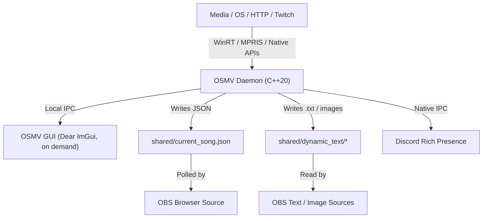

# OBS Stream Music Viewer (OSMV)

Welcome to the **StreamMusicViewer** organization! **OSMV v5.0.0** is an ultra-lightweight native **C++20** companion suite for OBS Studio and Discord Rich Presence. Rewritten from the ground up with **Dear ImGui** and a dual-process architecture, it combines real-time music overlays with Snaz-inspired streaming tools while keeping background RAM around **4.5 to 6 MB**.

## Features

- **Now Playing (OBS + Snaz exports)** — Detects active media every second via WinRT SMTC (Windows) and D-Bus MPRIS (Linux), exports `current_song.json` for the animated OBS Browser Source, and optionally outputs `TrackArtist.txt`, `TrackSong.txt`, `TrackAlbum.txt`, `PlayingNow.txt`, and `track-info.json`.
- **Album Artwork & Dynamic Color** — Displays cover art in OBS and adapts widget colors to the album palette, with an optional audio visualizer.
- **Discord Rich Presence** — Native C++ Discord IPC client displaying a Listening activity (`type: 2`) with iTunes artwork lookup, album metadata, and status badges.
- **Time, Date & Timers** — Real-time `Time.txt`, localized `Date.txt`, target `Countdown.txt`, `ChronoDown.txt`, and `ChronoUp.txt` (`$totalminutes`).
- **System Info** — Lightweight native hardware telemetry (`$CPU_USAGE`, `$RAM_MB_AVAIL`, `$RAM_%_IN_USE`, `$RAM_%_AVAIL`, `$AMOUNT_PROCESSES`, `$UPLOAD`, `$DOWNLOAD`) written to `SystemInfo.txt`.
- **Textline Changer & Dynamic Files** — Rotates custom messages (`TextlineChanger.txt`) and periodically fetches remote HTTP/HTTPS text or image files for OBS.
- **Twitch Helix Integration** — Exports live viewer counts (`TwitchViewers.txt`), searches categories, and updates stream title/game with saved presets.
- **Dual-Process Low RAM** — Event-driven GUI (~51–58 MB on Windows) terminates completely on **Headless Mode** / close, leaving only the ~4.5–6 MB background daemon in the system tray.

## How It Works

---

## Quick Start

### Windows

1. Go to the **[Releases](https://github.com/StreamMusicViewer/OSMV/releases)** page and download the latest `.zip` (or build from source with `windows\build.bat`).
2. Keep `OSMV.exe` alongside the `shared/` folder (`shared/index.html`, `shared/style.css`).
3. Run `OSMV.exe` (single standalone executable, no external DLLs required).
4. Configure OBS (see below).

### Linux

**Dependencies:** `dbus-1`, `libcurl`, `glfw3`, `OpenGL` (for `osmv-gui`; the `osmv` daemon requires only `dbus-1` and `libcurl`).

1. Go to the **[Releases](https://github.com/StreamMusicViewer/OSMV/releases)** page or build from source with `./linux/build.sh`.
2. Keep `osmv` and `osmv-gui` alongside the `shared/` folder.
3. `chmod +x osmv osmv-gui && ./osmv`
4. Configure OBS (see below).

---

## Configure OBS

1. **Music Widget**: Add a **Browser** source -> **Local file** -> select `shared/index.html` -> set **Width: 500**, **Height: 140**.
2. **Dynamic Text**: Add a **Text (GDI+)** (Windows) or **Text (FreeType 2)** (Linux) source -> check **Read from file** -> select any generated `.txt` file in `shared/dynamic_text/`.

*Close the configuration window anytime to enter Headless Mode while the daemon keeps running in the system tray.*

---

## Our Repositories

| Repository | Status | Description |
| :--- | :--- | :--- |
| **[OSMV](https://github.com/StreamMusicViewer/OSMV)** | Active (v5.0.0) | Native C++20 suite: Now Playing, Discord RPC, Timers, System Info, Dynamic Files, Twitch Helix, and ultra-low RAM daemon. |
| **[OSMV Lite](https://github.com/StreamMusicViewer/OSMV-lite)** | Archived | Archived — superseded by OSMV v5.0.0, which offers all features while using even less RAM. |

---

## Links & Creator
- **Documentation:** [streammusicviewer.github.io/OSMV](https://streammusicviewer.github.io/OSMV/)
- **Creator:** [@Ulyxx3](https://github.com/Ulyxx3)
- **License:** [MIT](https://github.com/StreamMusicViewer/OSMV/blob/main/LICENSE)
- **Troubleshooting:** [Troubleshooting Guide](https://github.com/StreamMusicViewer/OSMV/blob/main/TROUBLESHOOTING.md)

---
*Built for streamers who care about every detail and every megabyte of their broadcast.*
